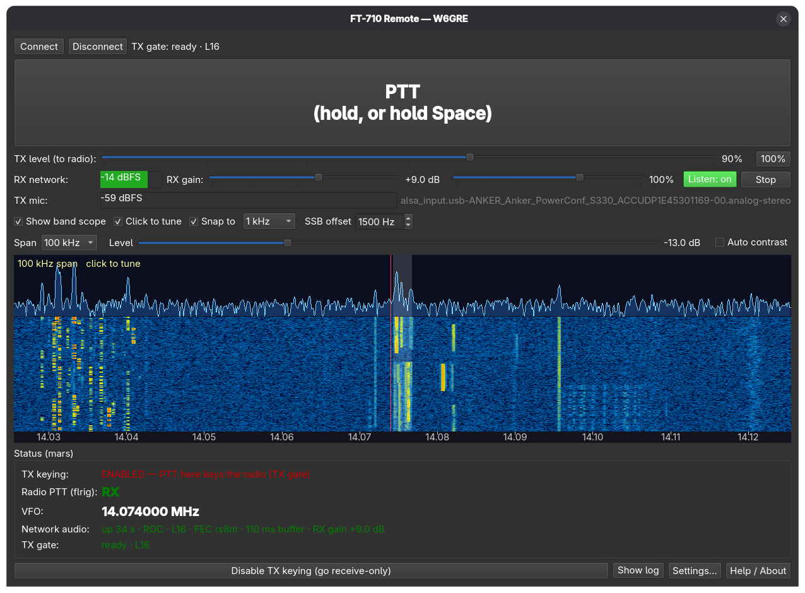

# FT-710_remote

Remote operation of a Yaesu FT-710 over a LAN or VPN: receive audio streamed with PipeWire
(ROC or RTP), push-to-talk with your microphone through an authenticated TX gate, TX level
control, and a live band scope (spectrum + waterfall) with click-to-tune.

It has two halves:

* **Client app** (`app/`, Qt 6, C++) – runs on the operator's Linux desktop.
* **Rig-side services** (`server/`, Python + PipeWire) – run on the Linux machine that is
  USB-connected to the FT-710, next to flrig.

> **Mumble was removed.** Earlier versions carried audio and PTT through a Mumble server
> (murmur), the Mumble client and a `radio-bridge` bot. That code, its unit file and the
> Mumble mode of the app are in git tag **`last-with-mumble`**
> (`git checkout last-with-mumble -- server/radio-bridge systemd/radio-bridge.service`).
> Settings from a Mumble-era install still load: the old Mumble keys are ignored and dropped
> on the next Settings → OK, and the old "Mumble" audio mode becomes ROC.



## Features

* **Network receive audio** – the rig host streams the radio's receive audio straight to the
  desktop with PipeWire (ROC with FEC, or RTP; optional Opus compression for VPN use). It
  appears as the input device **"FT-710 RX (network)"** for WSJT-X, fldigi etc., and
  **Listen** plays it on your speakers. See [Network audio](#network-audio).
* **PTT / TX** – hold the PTT button (or Space): your microphone goes to `ft710_txgate.py`
  on the rig host, which keys flrig only on an explicit PTT from the app and unkeys on its own
  if the app, the network or the audio goes away. See [TX gate](#tx-gate).
* **TX level** – a gain the TX gate applies before the radio (stored on the rig host in `tx_gain`).
  **RX gain** – applied on the desktop to the received stream (−6 to +20 dB, limiter, no clipping).
* **Band scope** – `ft710_scope.py` reads the FT-710's own scope data from the radio's
  internal FTDI FT4222 USB-to-SPI bridge, which appears on USB only when
  **MENU → SCU-LAN10 = ON**. The client shows spectrum + waterfall, with span and
  reference-level / auto-contrast controls, and **click-to-tune** (sets VFO-A via flrig;
  frequency only). Click the *middle of the signal* you want: in SSB the dial frequency is the
  suppressed carrier, so the click is mode-aware – **LSB / DATA-L: dial = click + SSB offset**,
  **USB / DATA-U: dial = click − SSB offset** (default 1500 Hz, the middle of the 300–2700 Hz
  passband; 0 = always direct). CW (the FT-710 shows the received carrier), AM, FM, RTTY and
  PSK tune directly to the click. **Snap to [0.5 kHz | 1 kHz]** (on, 0.5 kHz by default)
  then rounds the final dial frequency: an LSB click on 3.788678 → 3.790178 → **3.790000 MHz**;
  with Snap off it rounds to 10/100/500 Hz depending on the span. While hovering, the readout
  shows `cursor … → dial … (LSB +1.5 kHz)` and an outline shows exactly where the passband
  stripe will land after the click (same snapped dial, same geometry: LSB dial−2700…dial−300,
  USB mirrored), so putting the outline over a conversation and clicking centres it in the
  passband. Note: in SSB the FT-710's scope is *not* centred on the dial – it is centred on
  dial ∓ 1.5 kHz (the passband centre, reported in the scope frame's metadata). The client uses
  that radio-reported centre for the frequency axis; older builds assumed dial-centred and drew
  everything 1.5 kHz too high in LSB, so clicks on a signal landed ~1.5–2 kHz off.
  Settings: `scopeSnapKHz`, `scopeSnapStep` (500/1000), `scopeSsbOffset` (0–3000 Hz).
* Status of flrig PTT, the VFO, `tx_enabled`, the stream and the TX gate polled over ssh.
* **Keyboard tuning** – the arrow keys step VFO-A by 5 kHz (Left/Right) and 500 Hz (Up/Down)
  through flrig, only while the radio is receiving; the dial itself moves, so unlike a scope
  click the mode does not matter. A widget that uses the arrows (slider, spin box, the log)
  keeps them while it has focus.
* Window size, volumes and scope settings remembered between runs.

## Architecture

```
 operator desktop                                   rig host (USB to FT-710)
 ┌──────────────────────────┐                       ┌──────────────────────────────────────┐
 │ ft710-remote (Qt)        │──ssh (status, flrig──▶│ flrig  ──CAT──▶ FT-710               │
 │  click-to-tune, levels)  │   curl, tx_gain)      │                                      │
 │ "FT-710 RX (network)" ◀──┼── UDP ROC/RTP 10001 ──│ ft710-netaudio-send ◀─USB audio─ FT-710
 │ mic, PTT ────────────────┼── TCP+UDP 10010 ─────▶│ ft710-txgate ──USB audio──▶ FT-710   │
 │                          │                       │   └─ keys PTT via flrig XML-RPC      │
 │ band scope view ◀────────┼──── TCP 7355 ────────│ ft710-scope ◀─FT4222 SPI── FT-710     │
 └──────────────────────────┘                       └──────────────────────────────────────┘
```

* The client never talks to the radio directly. CAT goes through flrig on the rig host
  (flrig owns the serial port), reached as `ssh <rig> curl http://127.0.0.1:12345/RPC2`.
* ssh uses ControlMaster connection sharing, so polls are cheap. Set up key-based login.
* The stream sender and the scope streamer are receive-only: they never write to the radio.
  The TX gate is the only thing that plays into the radio and the only thing that keys it.

## Requirements

Client (operator desktop, Linux):
* Qt 6 (Widgets, Network), CMake ≥ 3.21, a C++17 compiler
* libopus (dev package), pkg-config
* PipeWire ≥ 1.0 (`pipewire`, `pw-record`, `pw-loopback`, `pactl`); `pipewire-module-roc` for ROC
* OpenSSH client with key login to the rig host

Rig host (Linux):
* flrig, configured for the FT-710 with XML-RPC enabled (default port 12345)
* PipeWire (`pactl`, `pacat`), `pipewire-module-roc` for ROC, GStreamer for Opus (see below), `curl`
* Python 3 (TX gate: standard library; libopus for Opus TX)
* FTDI **libft4222** (for the band scope; see below)

Debian/Ubuntu example (client): `sudo apt install qt6-base-dev libopus-dev cmake g++ pkg-config pipewire-roc`

## Rig-side setup

1. **flrig**: run it on the rig host with the FT-710 CAT port; enable XML-RPC.
2. **Rig config dir** (`~/.config/radio-bridge/` – the name is historical):
   ```sh
   mkdir -p ~/.config/radio-bridge
   cp server/ft710-txgate/bridge.env.example ~/.config/radio-bridge/bridge.env   # set RB_SOURCE / RB_SINK
   ```
   Find the radio's USB audio names with `pactl list short sources` / `pactl list short sinks`.
   `tx_enabled` in this dir arms TX keying (the app's "Enable TX keying" button creates or
   removes it); `tx_gain` holds the TX level.
3. **TX gate**: see [TX gate](#tx-gate) (installed, not enabled; the app starts it).
4. **Network audio sender**: nothing to install; the app writes its config and runs it over ssh.
5. **Band scope**:
   ```sh
   mkdir -p ~/ft710-scope && cp server/ft710-scope/ft710_scope.py ~/ft710-scope/
   # put libft4222.so in ~/ft710-scope/lib/ (see "FTDI library")
   mkdir -p ~/.config/ft710-scope
   cp server/ft710-scope/scope.env.example ~/.config/ft710-scope/scope.env    # set FT710_SCOPE_ALLOW to your LAN
   cp systemd/ft710-scope.service ~/.config/systemd/user/
   systemctl --user daemon-reload && systemctl --user enable --now ft710-scope
   ```
   Turn **MENU → SCU-LAN10 ON** on the radio, then check with
   `python3 ~/ft710-scope/ft710_scope.py analyze`.

For user services that must run without a login session: `loginctl enable-linger $USER`.

### udev rule (FT4222 access)

The FT4222 inside the FT-710 is USB `0403:601c`. Give the service user access:

```sh
sed "s/@USER@/$USER/" udev/99-ft710-ft4222.rules.in | sudo tee /etc/udev/rules.d/99-ft710-ft4222.rules
sudo udevadm control --reload-rules
sudo udevadm trigger --subsystem-match=usb --attr-match=idVendor=0403
```

### FTDI library

`libft4222` is proprietary FTDI software and is **not included** in this repository.
Download "LibFT4222" for Linux from FTDI's website (ftdichip.com → Drivers → D2XX /
LibFT4222), extract it, and copy the `libft4222.so.*` for your architecture to
`~/ft710-scope/lib/libft4222.so` (or point `FT710_SCOPE_LIB` at it). Tested with 1.4.4.

## Client setup

```sh
cmake -S app -B build -DCMAKE_INSTALL_PREFIX=$HOME/.local
cmake --build build -j
cmake --install build          # installs bin/ft710-remote and a .desktop file
```

On first start the **Settings…** dialog opens. Tabs:

* **Rig host** – ssh destination (`host`, `user@host` or an `~/.ssh/config` alias),
  flrig host/port as seen from the rig host, the rig config dir; a "Test ssh" button.
* **Band scope** – streamer host (blank = rig host) and port.
* **Network audio / TX** – RX stream (ROC / RTP), compression, port, buffer, packet size,
  ROC FEC, source node, send-to address; microphone, TX gate port and service. See below.
* **General** – station label for the window title, optional help/notes file, path of
  the settings file.

Changes are validated and apply immediately, no restart. Settings live in
`~/.config/FT-710_remote/ft710-remote.conf`.
`ft710-remote --print-config` prints the effective settings and exits.

Settings from an older build (`~/.config/<anything>/ft710-remote.conf`) are imported
once on first start; keys already present are not overwritten.

## Network audio

**Settings → Network audio / TX → RX stream**:

| Mode | What it does |
|---|---|
| **ROC** (default) | PipeWire `roc-sink` on the rig host → `roc-source` on the desktop, Reed-Solomon FEC (`rs8m`) repairs lost packets. Recommended on a LAN. L16 only. |
| **RTP** | PipeWire `rtp-sink` → `rtp-source`. Compression **None** (L16) or **Opus 24/32/48/64 kbit/s** for VPN / slow links. |

The stream itself is **receive only**; transmit goes through the [TX gate](#tx-gate).

How it works:
* **Start** (the button in the "RX network" row) starts the stream and the TX gate, **Stop**
  stops both, and the stream is stopped when the app quits (unless "keep streaming" is ticked).
  There are no separate Connect/Disconnect buttons any more; Start/Stop does both.
* The app writes the configs from built-in templates and runs them as systemd **user** units:
  `ft710-netaudio-recv` locally (config in `~/.config/FT-710_remote/netaudio/`) and
  `ft710-netaudio-send` on the rig host over ssh (config in `~/.config/ft710-netaudio/`).
  Nothing about your setup is hard-coded: the rig host is the ssh host from Settings, the
  source is the **Source node** setting or, if blank, `RB_SOURCE` from `bridge.env` in the rig
  config dir, and the destination is this computer's address as the rig host sees it
  (or the **Send to** setting).
* The sender captures only that node (`node.dont-fallback`): if the radio's USB audio is
  missing it is not started (no fallback to another microphone), and it is restarted when the
  device comes back.
* **Health**: the app meters the received level (shown as dBFS in the "RX network" row),
  polls both units, and treats digital silence for more than 2 s or a stopped unit as *link
  down*. It then restarts the sender (every third try both ends) with 1 / 2 / 5 / 10 s backoff.
  The status line shows state, uptime and restart count.
* **Listen** plays the stream on this computer's speakers via a `pw-loopback` with its own
  volume (0–150 %); on by default (it is the only local playback of the radio). It never
  changes what WSJT-X/fldigi record. The status line says when Listen is off.

**WSJT-X / fldigi**: choose **FT-710 RX (network)** as the audio input (WSJT-X: Settings →
Audio → Input; fldigi: Configure → Sound Card → PulseAudio/PortAudio capture). It is a
normal PipeWire/Pulse source (`ft710_rx_net`), mono 48 kHz.

**RX gain** (slider in the RX network row, −6 to +20 dB = 0.5×–10×, default +9.5 dB = 3×;
saved as `netaudio/rxGain`). It is applied on the desktop to what WSJT-X/fldigi, the level
meter and the listen monitor get, and changes live
(no restart, no dropout). A lookahead limiter (3 ms lookahead, 150 ms release) holds peaks at
−1 dBFS, so no slider position clips; double-click the value to reset it. The limiter is a
small LADSPA plugin (`app/netaudio/ft710_rxlimit.c`) compiled into the app and run in a
PipeWire filter-chain: the stream arrives as "FT-710 RX (network, before RX gain)"
(`ft710_rx_net_raw`) and the chain outputs "FT-710 RX (network)". Tests:
`app/tests/test_rxlimit.sh` (0 dBFS sine/square/noise/clicks at up to 20×) and `ctest` in the
build directory.

Requirements:
* PipeWire ≥ 1.0 on both computers (`pipewire -c`, `pw-record`, `pw-loopback`, `pactl`).
* **ROC**: `pipewire-module-roc` (roc-toolkit ≥ 0.4) on **both** computers
  (Fedora: `sudo dnf install pipewire-module-roc`; Debian/Ubuntu: `pipewire-roc` / `libpipewire-0.3-modules`).
* **Opus**: GStreamer on the rig host with the PipeWire and Opus plugins
  (`gst-launch-1.0`, `pipewiresrc`, `opusenc`, `rtpopuspay`; Fedora: `gstreamer1-plugins-base
  gstreamer1-plugins-good pipewire-gstreamer`). roc-toolkit 0.4 has no Opus codec and
  PipeWire's own RTP Opus encoder has no bitrate setting, so Opus is sent with GStreamer
  and received by PipeWire's `rtp-source` (`sess.media = "opus"`).
* Firewall on the desktop: UDP **port, port+1, port+2** for ROC (default 10001–10003),
  UDP **port** for RTP.

Measured on a LAN (FT-710 USB audio, mono 48 kHz, rig host sender / desktop receiver):

| Mode | Wire bitrate | Sender CPU | Receiver CPU | Notes |
|---|---|---|---|---|
| RTP L16, 10 ms packets | ~800 kbit/s | 1.7 % (pipewire, 11 MB) | 0.2 % | lossless; 95–150 ms with 100 ms buffer |
| ROC L16, rs8m FEC, 120 ms | ~1160 kbit/s (743 source + 411 repair + 4 control) | 1.6–1.8 % (10 MB) | 1.3–1.7 % | ~160–170 ms; survives packet loss |
| RTP Opus 24 kbit/s, 20 ms | 24 kbit/s payload, ~41 kbit/s on the wire | 2.7–4 % (gst-launch, 18 MB) | 0.4 % | 50 packets/s |
| RTP Opus 32 kbit/s | 25 kbit/s payload, ~42 kbit/s wire | 3–4.6 % | 0.4 % | VBR: SSB audio needs less than the target |
| RTP Opus 48 kbit/s | 53 kbit/s payload, ~70 kbit/s wire | 3.2 % | 0.3 % | |
| RTP Opus 64 kbit/s | 69 kbit/s payload, ~86 kbit/s wire | 3.4 % | 0.3 % | |

Opus is lossy; for digital modes on a LAN prefer L16. 32–48 kbit/s is plenty for SSB/FT8
over a VPN.

Receive latency, measured from the rig host's capture to arrival on the desktop (LAN, GCC-PHAT
cross-correlation over 2 s windows, ~5 min per mode; milliseconds):

| Mode | Median | p10 | p90 |
|---|---|---|---|
| RTP L16, 40 ms buffer | 59 | 53 | 65 |
| ROC L16, 60 ms | 82 | 77 | 94 |
| RTP Opus 32, 60 ms | 98 | 87 | 107 |
| RTP L16, 120 ms | 150 | 144 | 154 |
| ROC L16, 120 ms | 158 | 143 | 158 |
| RTP Opus 48, 120 ms | 171 | 161 | 177 |
| RTP Opus 32, 120 ms | 192 | 188 | 198 |

Lower buffers are fine on a quiet wired LAN; use 120 ms or more over Wi-Fi or a VPN.

Optional unit files (`server/netaudio/ft710-netaudio-send.service`,
`app/netaudio/ft710-netaudio-recv.service`): copy them to `~/.config/systemd/user/` if you
want the units to be regular installed services; the app then uses `systemctl --user
restart` instead of a transient `systemd-run` unit. The `*.in` files in the same folders are
the templates compiled into the app.

Command line (handy for testing; `--na-*` overrides are not saved):

```sh
ft710-remote --netaudio start [--na-mode roc|rtp] [--na-compression none|opus] [--na-bitrate 32] [--na-port N] [--na-latency MS] [--na-rx-gain 3|9.5dB]
ft710-remote --netaudio status --na-rx-gain 6dB   # set the gain on the running receiver (not saved)
ft710-remote --print-receiver-conf                # the PipeWire receiver config the app writes
ft710-remote --netaudio watch 30    # monitor a running stream: level, unit states, recoveries
ft710-remote --netaudio stop
```

## TX gate

`server/ft710-txgate/ft710_txgate.py` is the transmit path. The app holds one authenticated
TCP control connection to it (HMAC challenge with a shared token, heartbeat every 100 ms) and,
while PTT is held, sends the selected microphone as RTP over UDP on the same port (L16, or Opus
at the stream's bitrate when compression is on). The gate is the only thing that plays into the
radio's USB audio input (`RB_SINK` / `TG_SINK`) and the only thing that keys flrig.

```
 desktop: ft710-remote ── TCP 10010 (auth, HB, PTT) ──▶ rig host: ft710-txgate ── flrig set_ptt
          mic (pactl source) ── UDP 10010 RTP ───────▶            └─ pacat ──▶ FT-710 USB audio
```

Rig-host install (do **not** enable it; the app starts it when you press Start):

```sh
mkdir -p ~/ft710-txgate ~/.config/ft710-txgate
cp server/ft710-txgate/ft710_txgate.py ~/ft710-txgate/
cp server/ft710-txgate/txgate.env.example ~/.config/ft710-txgate/txgate.env   # set TG_ALLOW to your LAN/VPN
cp systemd/ft710-txgate.service ~/.config/systemd/user/
systemctl --user daemon-reload
```

It reads `bridge.env` in the rig config dir first (so `RB_SINK`, `RB_FLRIG_URL`, `RB_HANG_S` are
shared) and uses `tx_enabled` and `tx_gain` from `~/.config/radio-bridge/`. Needs Python 3,
`pacat` and libopus (for Opus). Open TCP+UDP `TG_PORT` (default 10010) in the rig host's
firewall for the allowed subnets. The token is created (mode 600) on first start; the app reads
it over ssh and never stores it.

Client: **Settings → Network audio / TX** → pick the **Microphone**, TX gate port and service. Then:

* **Start** checks flrig PTT is 0 and no keyed marker exists, starts `ft710-txgate`, reads the
  token and connects. The "TX gate" status row shows the link state; reconnects use 1/2/5/10 s
  backoff and never re-key by themselves.
* **PTT / Space** keys only when the link is ready and TX keying is enabled. The button shows
  TALKING when the gate reports the rig keyed; the RX/TX label comes from flrig. The "TX mic"
  meter shows your level; the TX level slider is applied in the gate.
  PTT is refused (and the meter says *not capturing — PTT blocked*) until the mic is actually
  capturing; the selected mic must exist (no silent fallback to another input) and pw-record
  errors are written to the log.
* **Stop** (and quitting) unkeys and stops the gate and the stream.

### CAT reset

The **CAT reset** button (bottom row, next to Settings…) power-cycles the FT-710 over its own CAT
serial port on the rig host, bypassing flrig — for a hung rig or flrig, as long as the radio still
accepts CAT. After a confirmation ("Power-cycle the FT-710 over CAT? flrig will be restarted.")
the TX gate (`ft710_txgate.py`, the same helper and auth on `TG_PORT`) runs it in its own
transient user unit (`ft710-catreset-<time>`), so it finishes even if the app or the gate stops:

1. refuse while the gate has the rig keyed or PTT is held in the app (flrig's PTT is only logged:
   a PTT stuck by flrig or the radio is one of the reasons to reset);
2. find flrig (desktop app or user unit) and stop it with SIGTERM, wait until the port is free;
3. open the CAT port from flrig's prefs (or the CP2105 `if00` by-id port) at the prefs' baud, 8N1;
4. `PS;` → `PS0;`, wait ~3 s and confirm the radio no longer answers;
5. `;` then `PS1;` within 1 s, wait ~10 s, verify `PS1;` and `TX0;`;
6. restart flrig the way it was running (desktop app → `systemd-run --user` in the graphical
   session with its original environment; unit → `systemctl --user start`), and report each step.

Only `PS;`, `PS0;`, `PS1;`, `TX;` and `;` can be written — never `TX1` or any key command. The
button is disabled while it runs; progress goes to the status line and the log. If the gate is
not running (not started, or it refuses because PTT is stuck) the app runs the same code over
ssh instead. On the rig host: `python3 ~/ft710-txgate/ft710_txgate.py --cat-reset --dry-run`
checks everything without stopping flrig or sending anything.

Note: flrig's `restore_*` settings make it write back the radio state it found at startup when it
closes, so the frequency/mode after a reset may be what flrig started with.

Gate behaviour: key → 70 ms TX delay → fade in; on release drain, fade out, 0.7 s hang, unkey.
It unkeys at once on control-connection loss, a heartbeat older than 500 ms, no mic audio within
2 s of keying (`TG_FIRST_AUDIO_S`), a mid-over audio gap over 2 s (`TG_GAP_S`; silence is played
during shorter gaps), the 120 s TX timeout (then PTT must be released first), `tx_enabled`
removed, or service stop; `ExecStopPost` unkeys after a crash (only if its own keyed marker
exists). It also still refuses to key while a legacy `radio-bridge` unit is active.
Settings: `server/ft710-txgate/txgate.env.example`.

Tests (no radio, no real flrig, no sound card: a fake flrig XML-RPC server and a fake `pacat`
or a PipeWire null sink):

```sh
cd server/ft710-txgate
python3 test_txgate.py [--null-sink]            # the gate: auth, allowlist, timeouts, gaps, failsafes
python3 test_app_txgate.py ../../build/ft710-remote   # the real app (CLI + GUI PTT path) against the gate
python3 test_app_scripts.py                     # the app's ssh start/stop scripts with a temporary user unit
python3 ../../app/tests/test_ui_modes.py         # UI rows/sliders, old-settings migration (offscreen, temp config)
```

## Safety

* The TX gate keys the radio **only while `~/.config/radio-bridge/tx_enabled` exists**
  on the rig host, and only on an explicit PTT from the authenticated app. Remove the file
  (or use the client's "Disable TX keying" button) to make the system receive-only.
* Hard **transmit timeout of 120 s**; the gate unkeys by itself when heartbeats or audio stop,
  and `ExecStopPost` unkeys via flrig if it dies while keyed (see [TX gate](#tx-gate)).
* The stream sender, the scope streamer and click-to-tune never key the transmitter;
  click-to-tune changes only VFO-A frequency.
* You are responsible for operating within your license and local regulations,
  including control-operator requirements for remote operation.

## Credits

* [wfview](https://wfview.org/) – FT-710 scope frame layout and FT4222 handling
  (`yaesu_scope_data`, `ft4222handler`).
* [ratmandu/YaesuWFTesting](https://github.com/ratmandu/YaesuWFTesting) – Yaesu
  SCU-LAN10 / FT4222 waterfall experiments.
* VLSC – prior work on the Yaesu scope stream.
* flrig, PipeWire, roc-toolkit.

Copyright 2026 Jim Howard. Licensed under the Apache License, Version 2.0; see [LICENSE](LICENSE).
